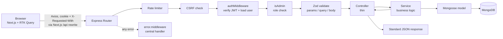

# Architecture & Database Design

## Request lifecycle



Layers and their single responsibility:

| Layer | Responsibility | Never does |
|---|---|---|
| `routes/` | Map URL + method → middleware chain → controller | Queries, business rules |
| `middleware/` | Cross-cutting checks (auth, role, validation, limits, errors) | Business logic |
| `controllers/` | Read `req.validated`, call a service, choose status code, shape response | Queries, aggregations |
| `services/` | Business rules and all database access | Touch `req`/`res` |
| `models/` | Schema, validation, indexes, derived fields | HTTP concerns |

The Express app (`app.js`) is separate from the process entry point (`server.js`), so tests mount the app with Supertest without
opening a port. `server.js` connects to MongoDB **before** listening and shuts down gracefully on `SIGINT`/`SIGTERM`.

## Frontend

`client/src` is organised by responsibility: `features/*` hold RTK Query endpoint definitions per domain, `services/baseApi.js` is the single
Axios-backed `createApi`, `app/*` holds the Next.js routes (thin files that render `views/*`, the page components), `components/*` are reusable pieces (ui, forms, tables, charts, feedback, layout),
`schemas/*` are Zod schemas shared by the forms, and `hooks/useListParams` keeps list state in the URL.

* **Server state** lives only in RTK Query's cache. Redux holds one tiny slice (`sessionExpired` flag).
* **Session** is whatever `GET /auth/me` says. `ProtectedRoute` renders children only after it succeeds.
* **Cache invalidation** is tag based (`Doctor`, `DoctorList`, `Patient`, `PatientList`, `Dashboard`, option lists). For example, creating a patient
  invalidates patient lists, the doctor's detail and the doctor list (patient counts), filter options and every dashboard query.
* **Routing:** Next.js App Router. All protected routes live in the `(dashboard)` route group, whose layout wraps them in `ProtectedRoute` + `DashboardLayout`; `login` is outside it. List state is kept in the URL via `next/navigation`. Routes are code-split per page, so Recharts only loads with the dashboard.
* **Same-origin API:** `next.config.mjs` rewrites `/api/*` to Express, so the HTTP-only cookie is first-party and CORS is not needed in development.

## Data model

```
User(name, email*, passwordHash, role, isActive, timestamps)
Doctor(name, specialization, hospital, phone, email*, nameLower, nameTokens[], timestamps)
Patient(name, doctor→Doctor, age, gender, phone, condition, notes, nameLower, nameTokens[], timestamps)
        * unique
```

The **Patient collection is the source of truth** for the relationship. There is no array of patient IDs on Doctor, so there is nothing
to keep in sync and no unbounded array growth. Patient counts are computed with a grouped query.

**Deletion policy.** Deleting a doctor who still has patients is refused with `409`. Patients are never silently deleted or orphaned.
Patients are hard-deleted (no soft delete). Known limitation: the "no patients" check and the delete are separate operations, so a patient
created in the gap could reference a deleted doctor. A multi-document transaction (requires a replica set) would close it. The UI renders
"Unavailable" for any unresolved doctor reference.

## Search strategy

Options considered:

1. **Unanchored case-insensitive regex** (`/term/i`). Easy, but cannot use an index efficiently: it scans the whole collection. Rejected.
2. **`$text` index.** Indexed, but matches whole (stemmed) words only; typing "rahm" would not find "Rahman". Poor for type-ahead. Rejected.
3. **Prefix search on pre-normalised fields (chosen).** Names are stored lower-cased in `nameLower`, and each word in `nameTokens`.
   A case-sensitive anchored regex (`^term`) on a lower-cased field can use index bounds.
   `search=khan` finds "Sara Khan" via the multikey `nameTokens` index; `search=sara kh` finds it via `nameLower`.
   Doctor search also matches an email prefix through the unique email index.

The three `$or` branches are each served by their own index.

**Limitations:** matches word *starts* only, not the middle of a word ("ahman" will not find "Rahman"); no typo tolerance or ranking; the
derived fields add small write and storage overhead and are maintained by a `pre("validate")` hook, which is why updates go through
`doc.save()` rather than `findOneAndUpdate`. For richer search (fuzzy, ranking), use Atlas Search or a dedicated search engine.
Search input is escaped and capped at 50 characters.

## Indexes and the queries they serve

| Collection | Index | Query pattern it serves | Trade-off |
|---|---|---|---|
| users | `{ email: 1 }` unique | Login lookup; one account per email | none |
| doctors | `{ email: 1 }` unique | Duplicate prevention; email-prefix search | none |
| doctors | `{ createdAt: -1 }` | Default listing order; date-range filter | none |
| doctors | `{ specialization: 1, createdAt: -1 }` | Filter by specialization, newest first; also sort-by-specialization via the leading key; `distinct("specialization")` | One extra index to maintain on every write |
| doctors | `{ hospital: 1, createdAt: -1 }` | Same, for hospital | same |
| doctors | `{ nameLower: 1 }` | Name-prefix search; sort by name | derived field |
| doctors | `{ nameTokens: 1 }` (multikey) | Any-word prefix search | larger index (one key per word) |
| patients | `{ doctor: 1, createdAt: -1 }` | Doctor's patients newest-first; per-doctor counts and the patients-per-doctor `$group`. Its `doctor` prefix also covers `{ doctor }` lookups, so **no separate `{doctor:1}` index** | none |
| patients | `{ createdAt: -1 }` | Global listing order; date-range filter; trends `$match` | none |
| patients | `{ condition: 1, createdAt: -1 }` | Condition filter + newest first; top-conditions grouping; `distinct("condition")` | none |
| patients | `{ nameLower: 1 }`, `{ nameTokens: 1 }` | Patient name search / sort | as above |

**Combinations that are deliberately *not* fully indexed.** A compound index only helps queries that use its prefix. Filtering by
*specialization AND hospital*, or by *doctor AND condition*, uses one index and filters the remainder in memory. That is acceptable at this
scale, and adding every combination would multiply write cost. If a particular combination becomes hot in production, add a specific
compound index for it. Sorting by `age` or `condition` without a filter is an in-memory sort (bounded by `limit`, 50 max).
The `$or` search combined with other filters lets MongoDB pick one index per branch; selective filters like `doctor` may win instead.

Other query practices used: projections (list queries omit `notes`), `lean()` for reads, `maxTimeMS` of 5 s, a hard page-size cap of 50,
`countDocuments` with the same filter as the list, one batched `populate` (a single `$in` query) rather than per-row lookups,
one grouped query for patient counts per page, and `$lookup` in the dashboard only *after* `$limit`.

In production `autoIndex` is **off**; run `npm run db:sync-indexes` as a deploy step.

### Verifying index use

`npm run db:explain` prints the winning plan and `executionStats` for the application's main queries. Output from a local run on the demo data
(8 doctors, 64 patients, MongoDB 8.3):

```
Doctors: specialization filter + newest first
  plan:        LIMIT > PROJECTION_SIMPLE > FETCH > IXSCAN(specialization_1_createdAt_-1)
  keys/docs:   1 keys, 1 docs examined
Doctors: name prefix search
  plan:        SUBPLAN > LIMIT > PROJECTION_SIMPLE > FETCH > OR > IXSCAN(email_1) > IXSCAN(nameLower_1) > IXSCAN(nameTokens_1)
Patients: doctor-scoped listing
  plan:        LIMIT > PROJECTION_SIMPLE > FETCH > IXSCAN(doctor_1_createdAt_-1)
Patients: condition filter
  plan:        IXSCAN(condition_1_createdAt_-1)
Patients: date range
  plan:        IXSCAN(createdAt_-1)
```

This confirms the planner **chooses** these indexes. It does not demonstrate a speed-up: with ~70 documents a collection scan would be equally
fast. Measure with realistic data volumes (tens of thousands of documents or more) before claiming a performance gain.

## Dashboard analytics

All figures come from MongoDB, never from hard-coded data.

* **Totals** use `estimatedDocumentCount()` (metadata, O(1)); range counts use `countDocuments` on the `createdAt` index.
* **Trends** group each collection with `$dateTrunc` (MongoDB ≥ 5.0) by day or month in UTC, and the service zero-fills missing buckets so the
  chart axis is continuous. Ranges are capped (366 days daily / 5 years monthly) to bound the work. The client switches to monthly
  buckets automatically for ranges over 120 days.
* **Patients per doctor** groups on `doctor`, sorts, limits, then `$lookup`s names for only the top N.
* **No server-side caching** was added. The client's RTK Query cache already deduplicates identical requests, and a shared cache would need
  explicit invalidation on every write. If the dashboard becomes hot, cache per-range results with a short TTL (e.g. 30–60 s) and accept slight staleness.

## Security model

* **JWT in an HTTP-only cookie** (`Secure` in production, `SameSite` configurable, `Path=/`). The browser JavaScript never sees the token; nothing is in localStorage.
  Claims: `sub`, `role`, `iss`, `aud`, `exp`; verified with a pinned algorithm (HS256).
* **Authorization state is re-read from the database on every request**, so deactivating a user takes effect immediately, and role changes
  don't depend on old token contents. The cost is one indexed `findById` per request.
* **No refresh tokens.** A single token with the lifetime from `JWT_EXPIRES_IN`; when it expires the user signs in again. Adding refresh tokens without rotation and
  revocation storage would be superficial, so it was left out.
* **CSRF:** `SameSite` + required `X-Requested-With` header + `Origin` allow-list (see `csrf.middleware.js`).
* **Brute force:** failed logins are limited per IP (successful logins do not count), keyed by IP rather than email so an attacker cannot lock a real admin out.
  There is no per-account lockout. Unknown emails still run a bcrypt comparison to keep response times similar.
* **Rate limits are per process** (in-memory store). With multiple instances, use a shared store such as Redis (`rate-limit-redis`) and pass it as the `store` option.
* **Injection:** every input is parsed by strict Zod schemas (unknown keys rejected, operators in objects fail type checks); sorts and filters are allow-listed; regexes are escaped.
* **Logging** records method, path (without query string), status and timing. Bodies, cookies and auth headers are never logged, and redaction is configured as a backstop.
* **Not a compliance claim.** This project does not claim HIPAA or any other regulatory compliance. It uses fictional data only.
